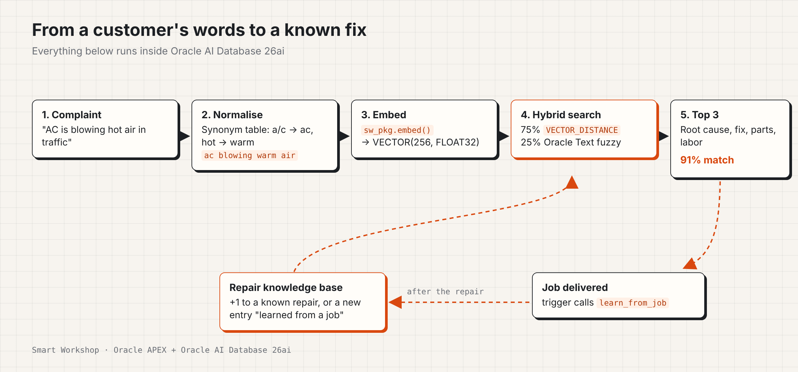
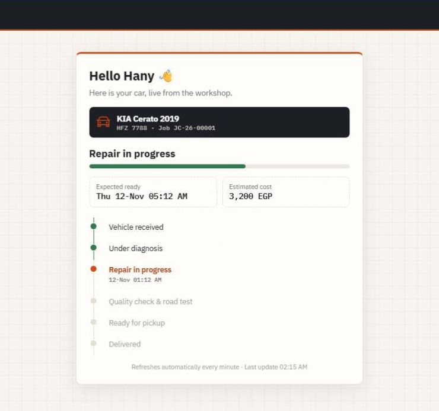

# Smart Workshop

An Oracle APEX app for car service workshops. It answers the two questions that eat a service advisor's day: *"What is wrong with my car?"* and *"Is it ready yet?"*

Built by Abdelrahman Atef on a free Oracle APEX workspace (APEX 26.1, Oracle AI Database 26ai).

Read the story behind it on Medium:https://medium.com/@mohamedabdelraziek80/is-my-car-ready-building-a-self-learning-workshop-app-with-oracle-apex-0e6ad3d40343?sharedUserId=mohamedabdelraziek80



## What it does

- **Job cards** for every car: complaint, technician, estimate, promised time and seven statuses from "Vehicle received" to "Delivered".
- **Diagnosis assistant.** While the advisor types the complaint, it shows the three most similar repairs the workshop already solved: root cause, fix, parts and labor time.
- **Self-learning knowledge base.** When a job is delivered, its diagnosis and fix are added to the knowledge base automatically.
- **Workshop board.** A Kanban board with one column per status. Drag a card to move the car.
- **Customer tracking page.** Opened from a QR code or a WhatsApp link. No login. Shows the status, a timeline, the expected time and the estimate. The customer can rate the service once the car is ready.
- **Service reminders** for cars due for their 10,000 km or six-month service, with a WhatsApp reminder link.
- **Dashboard** with live counts, late jobs, open jobs per technician and the average customer rating.



## How the diagnosis search works

1. **Synonyms.** A small table maps the words customers and technicians actually use to one term (`a/c`, `aircon`, `air conditioning` -> `ac`). The workshop can add rows.
2. **Embedding.** `sw_pkg.embed()` turns the normalised text into a `VECTOR(256, FLOAT32)`. It is written in PL/SQL (feature hashing of terms, word pairs and character trigrams) because the free workspace does not allow loading an ONNX model. Swapping in `VECTOR_EMBEDDING` with a real model only means changing this one function.
3. **Hybrid ranking.** 75% `VECTOR_DISTANCE` (cosine, with a vector index) and 25% Oracle Text fuzzy score.

## Oracle features used

| Area | Feature |
| --- | --- |
| Oracle AI Database 26ai | `VECTOR` data type, `VECTOR_DISTANCE`, vector index (IVF) |
| Oracle Text | `CONTEXT` index, `FUZZY`, `ACCUM` |
| Oracle APEX | Interactive Reports, Forms, Dynamic Content regions, Dynamic Actions, AJAX Callbacks, Charts, public pages, PWA |
| APEX APIs | `APEX_BARCODE.GET_QRCODE_SVG`, `APEX_PAGE.GET_URL`, `APEX_JSON`, `APEX_ESCAPE` |
| PL/SQL | `SW_PKG` (embedding, synonyms, learning, Cairo time), `SW_API` (board and rating), triggers |

## Repository

```
sql/smart_workshop_install.sql   tables, Oracle Text index, vector column and index, packages, views, sample data
apex/f192128.sql                 APEX application export
apex_page_code/                  the PL/SQL and CSS behind the custom regions, for reading
images/                          screenshots and the diagram
```

## Install

1. In your APEX workspace open **SQL Workshop > SQL Scripts**, upload `sql/smart_workshop_install.sql` and run it.
2. Open **App Builder > Import**, choose `apex/f192128.sql` and install it on the same schema.
3. Run the app. The public tracking page is page 100 and takes the job's tracking token as `P100_T`.

Requires Oracle Database 23ai/26ai (for the `VECTOR` type) and APEX 24.1 or later.

## Notes

- All names, plates and phone numbers in the sample data are made up.
- Times are stored in Africa/Cairo local time. Change `sw_pkg.local_now` for another time zone.
- Tracking links use a random 32-character token, not the job ID.

## License

MIT
